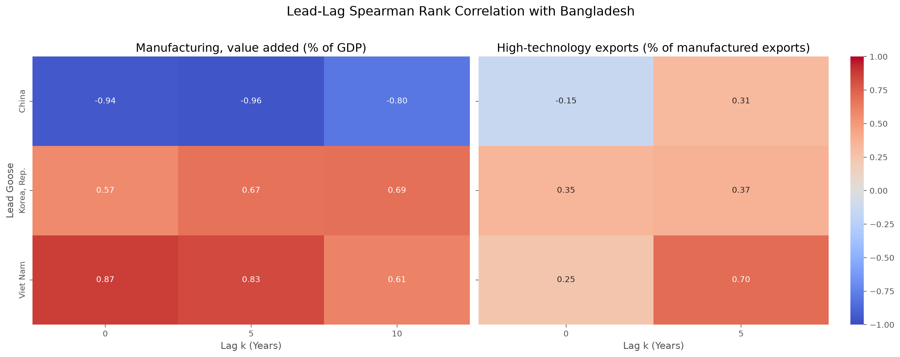
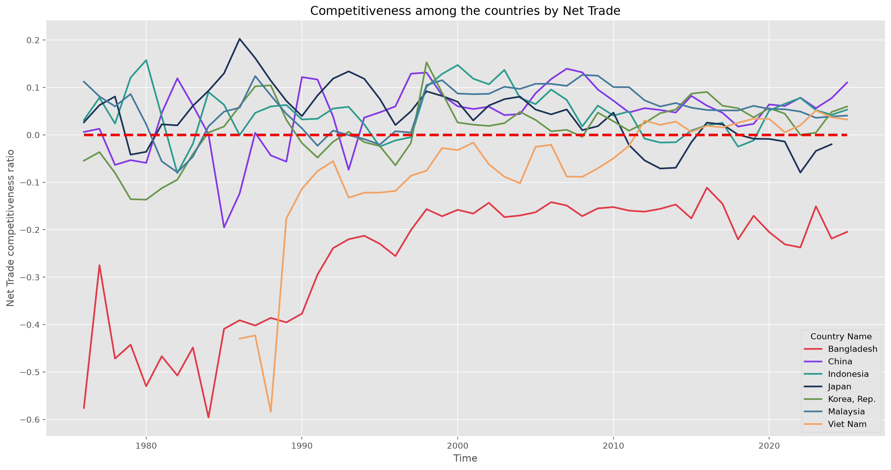
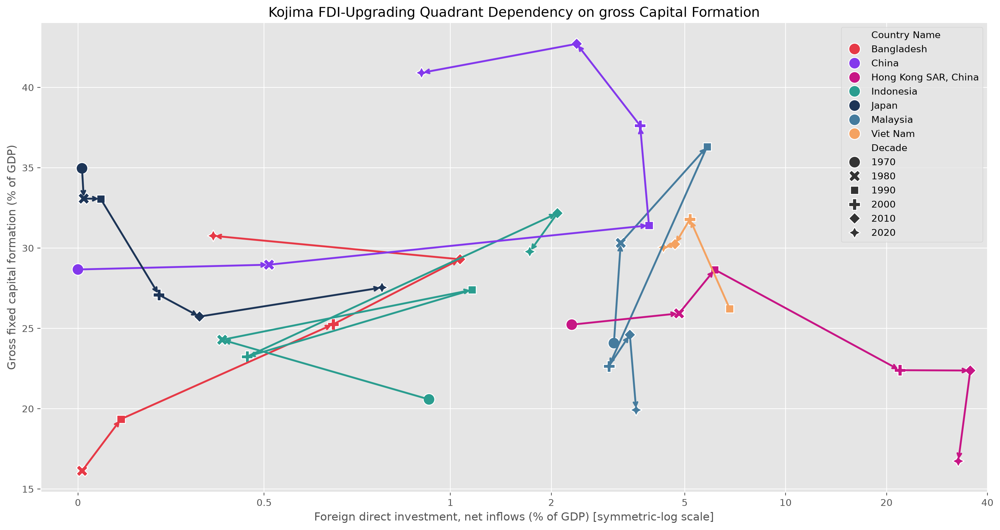
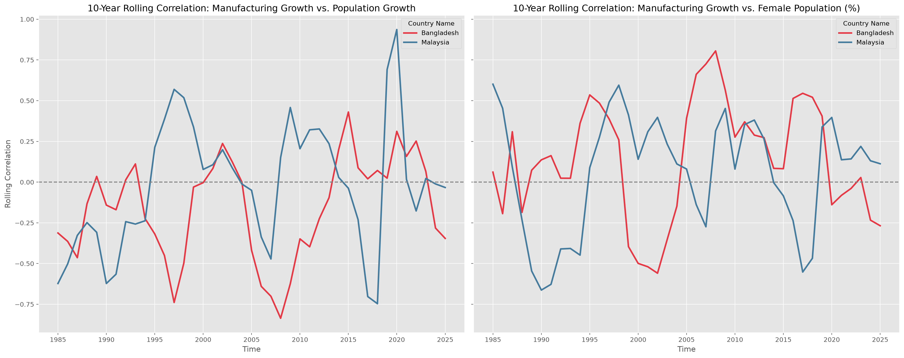
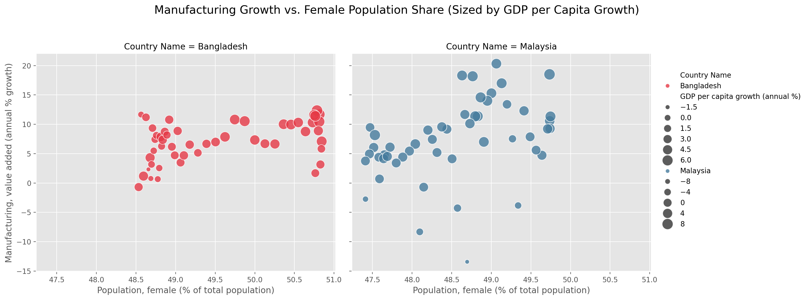
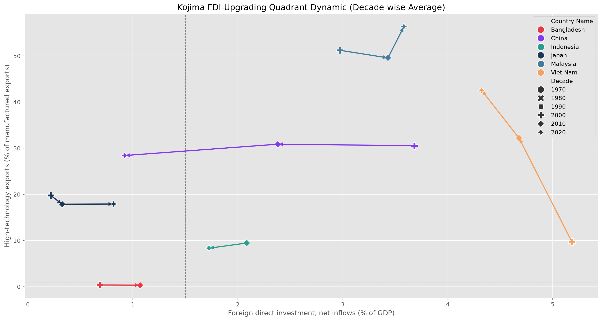
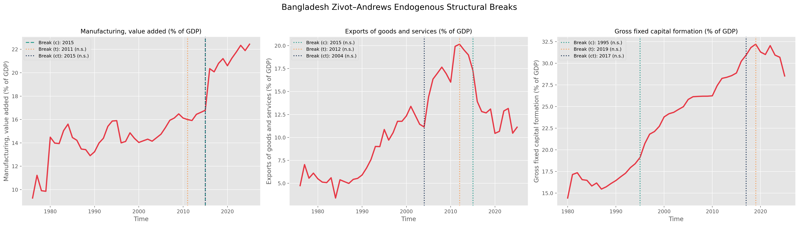
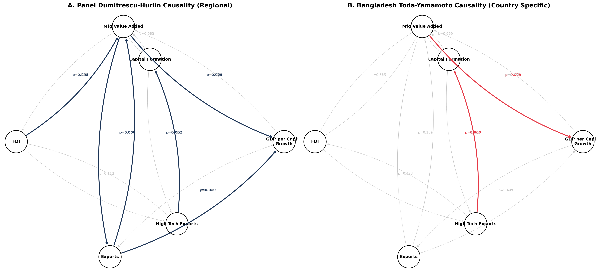

# A high-tech, export-driven economy could make Bangladesh the next Flying Geese follower.

Author: Mohammad Jawad Hasan supervised by Prof. Dr. Israt Rayhan

## Introduction

The Flying Geese Paradigm is an economic model introduced by the economist Kaname Akamatsu. It describes how developing nations, especially in East Asia, industrialize rapidly by catching up with more advanced economies. Akamatsu showed how Japan, the lead goose, passed basic manufacturing and electronic assembly down to the first-tier followers (South Korea, Taiwan, Hong Kong and Singapore), who in turn passed it on to second-tier nations such as Malaysia, Thailand and Indonesia.

Akamatsu's original study did not mention Vietnam. We include it here because its economic path closely resembles that of Bangladesh, which is our focal point. Each of these countries followed the same rule of thumb: Import–Production–Export. They imported advanced goods, began manufacturing domestic substitutes, and eventually moved their economies toward an export-driven trade pattern in high-tech industries worldwide.

## Source of Data

The secondary data come from the World Development Indicators (WDI) of the World Bank. They cover nine countries (Bangladesh, China, Indonesia, Japan, Korea Rep., Malaysia, Philippines, Singapore and Vietnam) and 24 indicators, including GDP per capita, Manufacturing value added (% of GDP) and High-technology exports (% of manufactured exports). The sample period runs from 1975 to 2025.

## Methodology

To keep our conclusions statistically and econometrically reliable, the study combines several time-series comparisons with an extensive literature review. The dependent variable is GDP per capita growth (annual %). We want to observe how Bangladesh behaves over time compared with other large and growing economies. To identify structural breaks in annual fluctuations, we used the Chow test, which detects changes in economic behavior across years. To locate the breaking points themselves, we also used the Zivot-Andrews endogenous structural break unit root test.

For a clearer comparison among countries, we used the following:

1. **Chow Test and Zivot-Andrews Test:** structural breaks in economic behavior, and the years in which they occur.
2. **Seasonality Decomposition Method:** tests whether genuine annual growth is visible once trend, seasonal and residual components are separated.
3. **Spearman Rank Correlation:** compares Bangladesh with the leading geese in terms of manufacturing and high-technology exports.
4. **Net Trade Competitiveness Ratio:** helps us understand endogenous growth.
5. **Kojima FDI-Upgrading Quadrant:** plots Foreign Direct Investment against high-technology exports over the decades to show each country's economic behavior and trajectory.
6. **Granger Causality Network:** a stochastic graph that shows directly how different interconnected indicators contribute to growth.
7. **Augmented Dickey-Fuller and KPSS Tests:** check the stationarity (unit root behavior) of the indicators for each country, especially Bangladesh.

## Workflow

The rest of the study follows the workflow below and shows how a high-tech, export-based economy could be the key to Bangladesh's prosperity.

{width=35%}

## Comparison with Bangladesh

According to our WDI analysis, Bangladesh's current economic progress looks stagnant and flat, despite a severe drop in GDP per capita growth after COVID-19. However, the Chow test results show that Japan, China, Korea Rep. and Singapore did not suffer a pandemic-era decline. So before we discuss growth per capita, the pandemic needs to be addressed. The Chow test results for the given panel regression are as follows:

| Country Name | Breakpoint Years |
|---|---|
| Bangladesh | 2019 |
| China | N/A |
| Indonesia | 1995–2019 (every year) |
| Japan | N/A |
| Korea, Rep. | 1995–2008 (every year) |
| Malaysia | 1999, 2000, 2005, 2013–2019 |
| Philippines | 2016–2019 |
| Singapore | N/A |
| Viet Nam | 2019 |

Almost every country was economically affected by the COVID-19 pandemic, except China, Singapore, South Korea and Japan, which we know as the leading geese.

With that acknowledged, we can look at Bangladesh's situation through the decomposed time-series graph of GDP per capita growth (% annual).

The graph shows that the seasonality of the Bangladesh economy is very inconsistent, but before 2019 the trend was moving upward.

To compare Bangladesh with these leading countries, we looked at the similarity of their economic strategies, first among the giants and then with Bangladesh. The Spearman rank correlation heatmap below gives a clear picture of the relationship between the manufacturing industry and high-tech exports across countries, at lags from the current year up to 10 years:

Bangladesh depends heavily on the RMG sector, so it makes sense that Vietnam is highly and positively correlated with it in manufacturing over the last five years; a decade earlier the correlation was still positive but only moderate. South Korea shows a moderate correlation with Bangladesh in manufacturing. The most interesting result is that China shows a strong *negative* correlation with Bangladesh in the same field, which is notable because China is one of Bangladesh's main competitors in the global RMG market.

For high-technology exports (% of manufactured exports), Bangladesh shows a weak correlation with almost all of these countries, the exception being Vietnam. The strong correlation at lag 5 exists because Vietnam only recently started producing high-technology goods and earning profitable exports from them, which was not the case five years earlier.

## Pacing of Bangladesh

Before COVID-19, Bangladesh's GDP per capita growth was trending upward. But an upward trend does not show the whole picture. To follow the Import–Production–Export pattern, we focused on export- and import-related variables such as Net Trade Competitiveness (NTC), defined as:

> **NTC = (Exports (% of GDP) − Imports (% of GDP)) / Trade (% of GDP)**, calculated for each country *i* and year *t*.

NTC gives a clear view of a country's trade history over time. We compared the countries with Bangladesh in the following graph to see the gap between exports and imports:

Most of the countries we considered have a positive NTC. In the 1980s Vietnam's NTC curve was below Bangladesh's, but after 2012 it crossed the zero line and kept growing. Bangladesh, however, stays below the zero line throughout. Its trade balance is always negative, unlike the developed and developing countries, both the flying geese leaders and the followers.

Could this be because Bangladesh's economy is more inward-moving, meaning it depends mostly on Gross Capital Formation rather than Foreign Direct Investment (FDI)? Here is the trajectory of Gross Capital Formation for these countries over the past decades:

According to the Kojima FDI-upgrading quadrant, Bangladesh has been heavily dependent on an inward-moving economy, relying on gross capital formation, for the past few decades. Many countries show a rising dependence on gross capital formation, while some show a declining trajectory when it comes to FDI.

Is Bangladesh struggling because of its massive population, in terms of employment, health, female empowerment and other indicators? To find out, we compare Bangladesh with Vietnam, which recently crossed the zero NTC margin, and check whether population growth correlates with the strong growth of Vietnam's manufacturing.

Female employment should be taken into consideration, since employing half of the population is an important factor for economic growth.

The scatterplot shows that the majority of Vietnam's population is female, and that Vietnam has managed to bring a large share of women into employment, supporting both manufacturing growth and GDP growth. This is another area where Bangladesh can improve.

### What the updated WDI panel tells us

The broader audit of the supplied WDI panel adds an important qualification to the earlier narrative. Bangladesh has experienced substantial **industrial deepening and domestic capital accumulation**, but these trends alone do not demonstrate that it has completed—or is currently following—the full Flying Geese sequence.

- **Manufacturing deepened:** manufacturing value added rose from **9.28% of GDP in 1976 to 22.44% in 2025** (+13.16 percentage points; Spearman trend correlation \u03c1 = 0.871, n = 50, p < 0.001). Industry value added rose from **14.45% to 34.03% of GDP** over the same period (\u03c1 = 0.966, n = 50, p < 0.001).
- **Trade integration improved, but remains comparatively shallow:** exports of goods and services increased from **4.75% to 11.12% of GDP**, while trade rose from **22.38% to 27.95% of GDP**. Vietnam's 2025 exports/GDP and trade/GDP ratios were much higher, at approximately **98.24%** and **190.34%**, respectively. These ratios measure gross cross-border flows, not domestic value added.
- **Capital formation rose strongly:** gross fixed capital formation increased from **14.44% of GDP in 1980 to 28.54% in 2025** (\u03c1 = 0.964, n = 46, p < 0.001). By contrast, FDI net inflows were only **0.39% of GDP in 2025**, compared with **4.27% in Vietnam** and **4.58% in Malaysia**. These descriptive comparisons do not prove that low FDI caused weak upgrading.
- **High-tech export evidence is weak for Bangladesh:** the supplied series has only **10 observations (2008–2018)**, ranging from **0.44% to 0.54% of manufactured exports**. This short series cannot support a confident claim about Bangladesh's long-run technological trajectory.

Taken together, the evidence supports a cautious conclusion: Bangladesh has industrialised and accumulated capital, yet the aggregate indicators do **not** establish a clear transition into higher-complexity export production. The Flying Geese hypothesis concerns shifts in product-level comparative advantage and the relocation of production between economies; GDP shares alone cannot verify that mechanism. In addition, the supplied data show Bangladesh's exports/GDP rising over the long run, so claims that exports simply “collapsed” or that manufacturing became definitively inward-looking should be treated as hypotheses requiring further testing, not as settled facts.

**Next empirical step:** analyse HS-level trade data from [UN Comtrade](https://comtradeplus.un.org/) or [CEPII BACI](https://www.cepii.fr/CEPII/en/bdd_modele/presentation.asp?id=37). Calculate revealed comparative advantage (RCA), product entry and exit, export diversification, and overlap between Bangladesh's export basket and those of earlier industrialisers. This would test the product-level “baton pass” more directly. The WDI high-tech-export indicator should be reported with its actual coverage, not extrapolated beyond the observed years.

## Why Bangladesh Is Failing

Akamatsu showed that follower countries focused on globally trending manufactured products, mostly assembling imported raw materials and then exporting them in bulk for profit. In recent decades, high-tech industries have been booming. Technology keeps advancing and the demand for digital products has risen rapidly. Both leading and follower countries adapted their industries to the global market alongside their local market. This not only employed their populations but also raised manufacturing's contribution to GDP and helped them keep a stable NTC above the zero line. So let's look at Bangladesh's movement in the Kojima FDI-upgrading quadrant against the high-tech share of manufactured exports:

Because Vietnam attracted high FDI (4–5% of GDP), its high-tech exports rocketed from **10% in the 2000s to over 42% in the 2020s**. Bangladesh, starved of FDI, has **flatlined at around 0.5% high-tech exports**. This explains why Bangladesh has not kept pace as a follower country, while Vietnam, on the other side of the coin, achieved great and consistent success.

## The Structural Break & Broken Causality

Bangladesh has not been able to create any substantial growth in GDP per capita. The Zivot-Andrews endogenous break tests show several breaks, each tied to a different part of Bangladesh's economic context:

Manufacturing value added (% of GDP) had a huge spike in 2015. Exports of goods and services (% of GDP) broke in 2004, raising the share from 11.25% to as much as 20.00%. Gross fixed capital formation (% of GDP) spiked more recently, in the 2018–2019 period. *In simple words:* after 2012–2015, Bangladesh's manufacturing growth became increasingly inward-looking (serving the domestic market rather than expanding its export share), while private capital formation began losing steam.

Next, the Dumitrescu-Hurlin and Toda-Yamamoto causality tests show why Bangladesh failed to upscale its market. The causality network graph below compares the regional picture with Bangladesh, to show where exactly Bangladesh should focus its effort instead of depending only on local markets, an inward-moving economy and domestic resources.

FDI strongly affects manufacturing value added for the East Asian regional countries (statistically significant, p = 0.006), whereas the same link for Bangladesh fails (statistically insignificant, p = 0.853). Because Bangladesh's exports collapsed in 2012 and the economy relies heavily on imports, the link between manufacturing and exports also fails for Bangladesh (p = 0.589), though it holds for the other ASEAN countries. By strengthening its manufacturing industries, Bangladesh can maximize GDP growth, given the causal connection between these two nodes (p = 0.029).

More interestingly, the high-tech exports link (p = 0.000, below 0.05) is also very helpful for Bangladesh. But we saw earlier that Bangladesh's high-tech exports are flatlined at around 0.5%. This redefines Bangladesh's objectives: it needs policy changes that ignite high-tech exports, which would directly stimulate a new wave of capital formation.

## Results and Discussion

The updated WDI panel supports a measured conclusion: Bangladesh has experienced substantial industrial deepening and domestic capital accumulation, alongside a rise in trade integration. These trends are compatible with parts of the Flying Geese story, but they do not prove that production has shifted to Bangladesh from earlier industrialisers in the specific product-by-product sequence proposed by the paradigm.

### Industrial structure and investment

Bangladesh's manufacturing value added increased from **9.28% of GDP in 1976 to 22.44% in 2025** (Spearman trend correlation \u03c1 = 0.871; n = 50; p < 0.001). Industry value added rose from **14.45% to 34.03% of GDP** (\u03c1 = 0.966; n = 50; p < 0.001). These are strong long-run trends, but a rising manufacturing share alone cannot identify which products Bangladesh gained, whether those gains followed another country's exit, or how much domestic value was created.

Gross fixed capital formation rose from **14.44% of GDP in 1980 to 28.54% in 2025** (\u03c1 = 0.964; n = 46; p < 0.001). FDI net inflows, however, were **0.39% of GDP in 2025**, compared with **4.27% in Vietnam** and **4.58% in Malaysia**. This is consistent with a larger role for domestic capital formation in Bangladesh's growth. It does not establish that Bangladesh received no technology spillovers or that FDI alone explains the differences in upgrading.

### Exports, imports and external integration

Bangladesh's exports of goods and services rose from **4.75% of GDP in 1976 to 11.12% in 2025** (\u03c1 = 0.761; n = 50; p < 0.001). Trade as a share of GDP increased from **22.38% to 27.95%** (\u03c1 = 0.736; n = 50; p < 0.001). Thus, the long-run WDI series does not support a simple claim that exports continuously collapsed. The series can still contain shorter downturns and structural breaks, but those need to be reported with their dates, definitions and uncertainty rather than generalized into a permanent collapse.

Vietnam's 2025 exports/GDP ratio was approximately **98.24%**, and its trade/GDP ratio was **190.34%**—far above Bangladesh's. These are gross-flow measures, not measures of domestic value added; re-exports and imported inputs can make exports/GDP exceed 100%.

The Net Trade Competitiveness ratio (NTC) defined earlier is a normalized trade-balance measure. A negative value indicates imports exceed exports in the chosen GDP-scaled series; it does **not**, by itself, prove that an economy is inward-looking or that every peer became a net exporter during its development. Interpret its trajectory alongside exports, imports, the trade balance, exchange-rate changes and the composition of traded products.

### High-technology exports and the upgrading question

The WDI high-technology-export indicator is especially incomplete for Bangladesh: only **10 observations from 2008–2018** are available in the supplied extract. Its share moved from **0.44% to 0.54% of manufactured exports**, with no statistically significant monotonic trend in that short sample (\u03c1 = 0.285; p = 0.425). Vietnam's available series rises from **8.84% in 2008 to 44.26% in 2023** (n = 16; \u03c1 = 0.971; p < 0.001). Because coverage differs, these figures should not be treated as a fully balanced comparison. Also, the high-tech share is not a direct measure of domestic technology content or local value added.

### What the existing export-import analysis can and cannot establish

The existing `export_import.ipynb` is useful as a complementary view of trade flows and should be read together with the aggregate WDI panel. However, no new analysis or newly validated result was added to that notebook in this update, so it should not be cited as independent new evidence. Export and import totals can show the scale and direction of trade, but aggregate totals cannot establish whether Bangladesh is taking over particular product categories from Japan, Korea, China or other earlier industrialisers.

The next step for a stronger Flying Geese test is product-level bilateral trade data (HS codes), ideally over a consistent period. Useful measures include revealed comparative advantage (RCA), products entering and leaving each country's export basket, export diversification, similarity/overlap between export baskets, and the timing of changes in market shares. Domestic value-added or manufacturing-subsector data would help distinguish assembly and imported-input processing from deeper domestic upgrading.

### Overall interpretation

**Bangladesh is partially consistent with industrial deepening and capital accumulation, but the available aggregate WDI evidence is insufficient to conclude that it is following the full Flying Geese sequence.** The strongest evidence is the rise in manufacturing/industry shares and gross fixed capital formation. Trade integration also increased, but remains much shallower than Vietnam's by the aggregate ratios examined. The high-tech export series for Bangladesh is too sparse for a confident trend conclusion.

These are descriptive trends and statistical associations, not causal estimates. Break tests, correlations, fixed-effects models and time-series diagnostics each depend on their assumptions and sample coverage; none alone proves that FDI, female employment, population growth or another factor caused industrial upgrading.

## Bottomline

Bangladesh has built a larger manufacturing base and increased domestic capital formation. That is meaningful progress, but it is not the same as proving a complete Flying Geese transition into higher-complexity, technology-intensive production. Compared with Vietnam, Bangladesh's aggregate trade integration is lower, and the available WDI high-tech export series is too short to provide a strong conclusion.

The most defensible next research step is to move from aggregate ratios to product-level trade: measure RCA, product entry/exit, diversification and export-basket overlap using [UN Comtrade](https://comtradeplus.un.org/) or [CEPII BACI](https://www.cepii.fr/CEPII/en/bdd_modele/presentation.asp?id=37). [UNIDO INDSTAT](https://stat.unido.org/) can complement this with manufacturing subsector output and employment. Until those checks are completed, the Flying Geese hypothesis remains plausible in parts, but not demonstrated by the current aggregate evidence.
